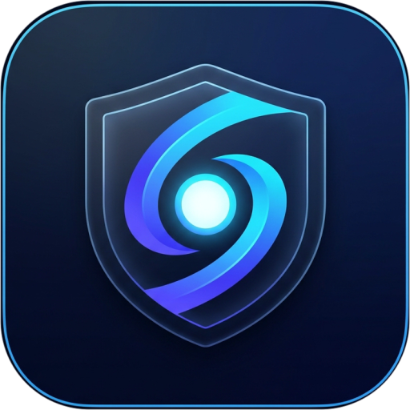

<p align="center">
  
</p>

<h1 align="center">APN — Remote Desktop &amp; Built-in L3 VPN</h1>

<p align="center">
  โปรแกรมรีโมตเดสก์ท็อป 60 FPS และ Virtual LAN (L3 VPN) ข้ามเครือข่ายอัตโนมัติในไฟล์เดียว<br />
  รองรับ Windows · Linux · macOS (ยังไม่รองรับมือถือ)
</p>

---

## จุดเด่นหลัก
- **เชื่อมต่อด้วยเลข 9 หลัก + รหัสผ่าน:** ใช้งานง่ายสไตล์ AnyDesk / RustDesk ทั้งในวง LAN และข้ามอินเทอร์เน็ต
- **ภาพลื่น 60 FPS (GPU H.264):** ใช้ Hardware Acceleration (Windows Media Foundation / NVENC / Intel QSV / AMD AMF / VideoToolbox) พร้อมโหมด Smart Tiles สำรองอัตโนมัติ
- **คีย์บอร์ดสมบูรณ์ (ไทย/อังกฤษ):** ส่ง Hardware Scan Code เต็มรูปแบบ รองรับปุ่มเปลี่ยนภาษาและคีย์ลัดครบ
- **Built-in L3 VPN:** สร้างการ์ดแลนจำลองในตัวสำหรับใช้งาน RDP, SSH, SMB หรือ Moonlight/Sunshine
- **ทำงานเป็นแอปเดสก์ท็อปเต็มรูปแบบ:** หน้าต่างแอปเดี่ยว ไร้หน้าต่างคอมมานด์ ซ่อนที่ System Tray เมื่อปิดหน้าต่าง และเปิดอัตโนมัติพร้อมเครื่องได้
- **ประวัติเครื่อง & อัปเดตตัวเองอัตโนมัติ:** แสดงสถานะออนไลน์สด คลิกเดียวเชื่อมต่อใหม่ และอัปเดตเวอร์ชันใหม่ได้จากในแอปพร้อมตรวจ SHA-256
- **ความปลอดภัย:** เข้ารหัส TLS 1.3 ระหว่างสองเครื่องและตรวจใบรับรองของเครื่องปลายทาง ทั้งทางต่อตรงและทางสำรอง 443 (ตัวกลางอย่าง Cloudflare เห็นแต่ข้อมูลที่อ่านไม่ออก), ยืนยันตัวตนด้วย PIN / รหัสผ่านถาวร (Salted SHA-256) และโหมดขออนุมัติก่อนเข้าควบคุม (Accept/Reject)
- **ลดการถูกมองเห็น:** ต่อตรงผ่าน UDP 443 แบบ HTTP/3 จึงดูเหมือนการท่องเว็บทั่วไป, พอร์ต WebSocket รับเฉพาะจากในเครื่อง ไม่เปิดให้เครือข่ายภายนอก และตั้งให้ไม่ประกาศตัวในวง LAN ได้ (การต่อตรงยังทำให้สองเครื่องเห็น IP ของกันและกัน)

---

## ดาวน์โหลดและเริ่มต้นใช้งาน
1. ดาวน์โหลดไฟล์ตามระบบปฏิบัติการจากหน้า [Releases ล่าสุด](https://github.com/MYSitthichat/APN/releases/latest)
2. ดับเบิลคลิกเปิดโปรแกรม (คอมโพเนนต์ที่จำเป็นจะถูกเตรียมให้อัตโนมัติ)
3. กดปุ่ม **ติดตั้ง APN ลงเครื่อง** เพื่อสร้างไอคอนหน้าจอ + เปิดอัตโนมัติพร้อมระบบ + ซ่อนที่ System Tray
4. กรอก **รหัสเครื่อง 9 หลัก** และ **รหัสผ่าน** ของเครื่องปลายทางเพื่อเริ่มรีโมต

### แพลตฟอร์มที่รองรับ
| แพลตฟอร์ม | ไฟล์ |
| :--- | :--- |
| Windows (Intel/AMD, ARM64) | `APN-v*-windows-amd64.exe`, `APN-v*-windows-arm64.exe` |
| Linux (Ubuntu/Debian `.deb` & Binary) | `APN-v*-linux-amd64.deb`, `APN-v*-linux-arm64.deb`, `APN-v*-linux-armv7.deb` |
| macOS (Apple Silicon, Intel) | `APN-v*-macos-arm64`, `APN-v*-macos-amd64` |
| iOS / Android | ยังไม่รองรับ (ยังไม่มีแอปมือถือ และหน้าแอปเปิดได้จากเครื่องที่รัน APN เท่านั้น) |

---

## การบิลด์จากซอร์สโค้ด (สำหรับนักพัฒนา)
ต้องติดตั้ง Go 1.27+ แล้วรัน:
```powershell
go test ./...
.\scripts\build-all.ps1
```

ดูประวัติการเปลี่ยนแปลงทั้งหมดได้ที่ [CHANGELOG.md](CHANGELOG.md)
